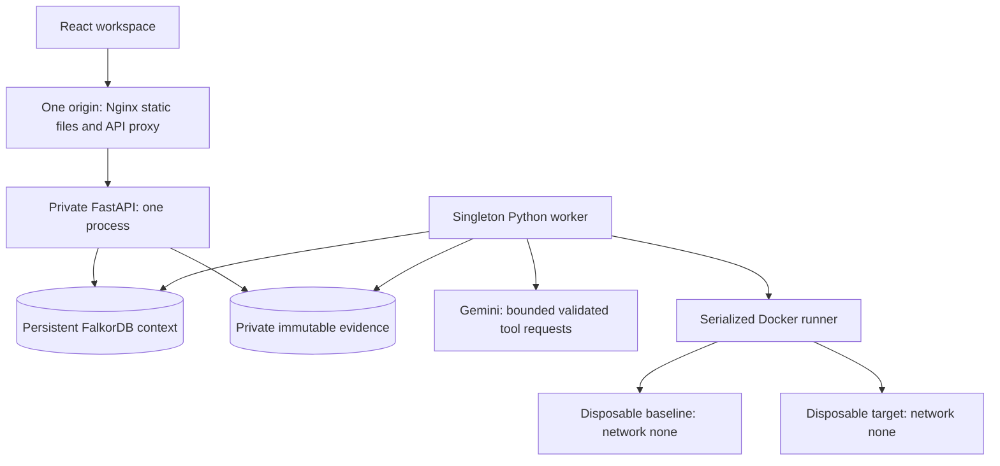

# FaultGlass

Investigate a reproducible Cypher difference across immutable FalkorDB engines. Follow graph-selected experiments, retain a smaller verified case, download regression artifacts, and inspect how verified history changes a later decision.

A failing query rarely explains its semantic neighborhood. FaultGlass connects language features, experiments, runs, behavioral families and prior investigations in FalkorDB so the next action has inspectable provenance. The built-in trailing-`MATCH` case reproduces a historical baseline error versus target crash. A baseline is not an oracle; disagreement and a behavioral family do not establish a source-code cause.

## Run locally

Use a persistent Linux/amd64 host with Python 3.12+, Docker Engine and Compose v2, systemd with cgroup v2/journal namespaces, and Nginx. Frontend tooling pins Node 24.19.0 and pnpm 11.25.0. Acquire both approved images explicitly and provision a worker-only Gemini key with an available model. Complete agent investigations require the key; standalone comparison does not.

Follow [setup and operations](deploy/SETUP.md) once to prepare the service account, locked dependencies, bounded persistent filesystems and private environment files. Then:

```sh
sudo /opt/faultglass/deploy/runtime up
curl http://127.0.0.1:8080/api/health
sudo /opt/faultglass/deploy/runtime status
```

Open [the local workspace](http://127.0.0.1:8080). Read context, worker, execution and agent readiness individually; `status: ok` alone is insufficient. Startup verifies the schema/catalog without resetting history. [Verification status](VERIFICATION.md) separates actual results from host/human checks still required. The prepared systemd installation still requires verification on a fresh supported host.

## Architecture and authority



FalkorDB owns admissions, revisions, reservations, experiment provenance and procedural memory. Files own immutable receipt/output bytes; a completed phase requires both to agree. Removing context prevents admission, retrieval, publication and learned selection. Browser caches are disposable. The URL identifies the investigation; versioned session storage retains only start key/digest/returned ID. Unsaved drafts do not survive refresh.

Gemini requests allowlisted tools and cited interpretations. Trusted deterministic code validates identities, citations, data permission, actions and budgets before dispatch. Only exact approved built-in cases and approved connected history may be transmitted. Public/synthetic import permission alone does not authorize model processing. Calls are durably reserved without automatic retries of uncertain inference. Exclusion, degradation and diagnostic mode remain visible and cannot certify a complete agent loop.

API and worker are trusted privileged services: the API retains Docker access for image preflight; only the worker runs engines. Both use the same account, absolute evidence root and account-level locks. Disposable engines receive no context/provider credentials, host mounts, socket, network or published ports.

## Graph model

The [authoritative contracts](apps/investigator/faultglass/context_models.py) define ten labels:

| Label          | Meaning                                                 |
| -------------- | ------------------------------------------------------- |
| EngineVersion  | Repository, commit, lineage and approved image identity |
| Investigation  | Episode with durable revisions and receipt heads        |
| FaultCase      | Canonical executable case and observation policy        |
| Fingerprint    | Conservative structural identity and features           |
| Feature        | Controlled semantic construct                           |
| Probe          | Versioned supported transformation                      |
| Run            | Role-specific observed execution                        |
| Divergence     | Deterministic paired signature                          |
| FaultFamily    | Evidence-backed behavioral profile                      |
| RegressionTest | Exported retained-case regression reference             |

| Source        | Relationship     | Target         |
| ------------- | ---------------- | -------------- |
| Investigation | STARTED_FROM     | FaultCase      |
| FaultCase     | HAS_FINGERPRINT  | Fingerprint    |
| Fingerprint   | USES_FEATURE     | Feature        |
| Probe         | TARGETS_FEATURE  | Feature        |
| Investigation | SELECTED_PROBE   | Probe          |
| Investigation | EXECUTED_AS      | Run            |
| Run           | ON_VERSION       | EngineVersion  |
| Run           | PRODUCED         | Divergence     |
| Divergence    | REDUCED_TO       | FaultCase      |
| Divergence    | MATCHES_FAMILY   | FaultFamily    |
| FaultFamily   | INVOLVES_FEATURE | Feature        |
| Probe         | EFFECTIVE_FOR    | FaultFamily    |
| FaultCase     | DERIVED_TEST     | RegressionTest |

Relationships carry stable identities and source provenance. Bootstrap installs indexes, features and probe definitions, never learned episodes or counters. Indexes do not enforce uniqueness; trusted writer locks and immutable conflict checks serialize publication. See [identities, schema and retrieval](apps/investigator/CONTEXT.md).

## Queries and algorithms

- [History](apps/investigator/faultglass/queries/history.cypher), [paths](apps/investigator/faultglass/queries/history-paths.cypher) and [supporting provenance](apps/investigator/faultglass/queries/history-provenance.cypher) connect matching features to compatible classified episodes and effective probes. Ordered engine scope, comparator version, disabled probes, superseded families and current-episode exclusion constrain usable history. Missing supporting evidence fails closed.
- [Selection](apps/investigator/faultglass/queries/probe-selection.cypher) saves the action before execution; [observations](apps/investigator/faultglass/queries/probe-observation.cypher) attach actual paired evidence. [Planner scoring](apps/investigator/faultglass/planner.py) uses `0.35 × feature fit + 0.30 × historical yield + 0.20 × version affinity + 0.10 × novelty − 0.05 × normalized cost`. It chooses the best compatible row without summing overlapping paths, breaks ties deterministically and rejects duplicate transformed cases. [Experiments](apps/investigator/PROBES.md) explains every factor.
- [Semantic mutations](apps/investigator/faultglass/probe_transforms.py) replace terminal MATCH with OPTIONAL MATCH or insert a binding-preserving WITH in a conservative procedure-call grammar. Unsupported syntax remains unresolved; the model cannot install arbitrary transformations.
- [Normalization](apps/investigator/faultglass/normalize.py) preserves types, sorts map keys/labels and excludes engine-local IDs. [Comparison](apps/investigator/faultglass/comparison.py) preserves ordered rows or compares unordered multisets with duplicates. Signatures bind observations, policy, comparator and engine identities. Explicit oracle assessment remains separate.
- [Reduction proposals](apps/investigator/faultglass/reduction_candidates.py) use supported query cuts and whole setup deletions. The [reduction service](apps/investigator/faultglass/reduction_service.py) repeats the source on fresh engines, then retains strictly smaller candidates preserving frozen fields and the exact divergence. Rejections stay inspectable. Bounded search implies neither universal minimality nor independent stability of every descendant.
- [Atomic publication](apps/investigator/faultglass/queries/runtime-commit.cypher) advances revision, domain links and receipt head together. [Memory contribution](apps/investigator/faultglass/memory_writer.py) and [provenance](apps/investigator/faultglass/queries/memory-provenance.cypher) use a classification-scoped idempotency key. Only eligible completed selections count; seeds, repeats and reducer candidates do not inflate attempts. Lost acknowledgments reconcile without another increment.

## Walkthrough

1. Choose **Trailing MATCH after a procedure call** and the available pair. Start once; double-click protection and durable idempotency preserve one admission.
2. Inspect baseline error, target crash, fingerprint and **Why this experiment?** Expand provenance and the actual selected action.
3. Review the repeated reduction source, accepted lineage and unsuccessful attempts. The current verified case remains authoritative while a candidate is pending.
4. Read the conclusion/limitations. Download case, regression scaffold and report. The scaffold needs explicit repository-harness wiring; a crash is not desired behavior.
5. Reload the URL, disconnect/reconnect, and reopen after an API restart. Reads reconcile saved evidence without submitting work again.
6. Start **Trailing MATCH with two node labels** as a distinct investigation. Inspect historical counterfactual and executed order. A score increase alone does not prove changed action.

The explicit [live acceptance check](apps/investigator/INVESTIGATIONS.md#verification) requires a complete source Explorer loop and a fresh related changed action, execution, exports and memory. Saved receipt audits are labeled as audits, never fresh runs.

## Limits and recovery

This shared workspace has no accounts or private cases. Use public/synthetic inputs. Per investigation: four probes, one source stability check, four reduction comparisons, 32 proposals, 900 seconds including downtime, 64 MiB artifacts and 512 events. Provider: twelve calls, fifteen seconds each, sixty total seconds.

Each engine has one CPU, 512 MiB without swap, 128 PIDs, 128 MiB private tmpfs, read-only root and dropped privileges. Startup/query/pair deadlines are 20/5/60 seconds with bounded cleanup. Capture caps: 1,000 rows, 1 MiB observations, 256 KiB logs, 8 MiB paired artifacts. Unsupported values and incomplete output cannot become equal results. The approved historical pair does not describe current release correctness.

Ingress commands allow exactly 327,680 bytes; canonical case validation allows 262,144 bytes. POST rate is one/second with burst five, with 64 concurrent requests/source. API parsing has a total fifteen-second body deadline. One API process enforces one new admission/ten seconds (conservatively shared across the proxy), eight queued jobs and sixteen streams. Forged forwarding headers do not change accounting. Ordinary reads/exact-key recovery admit no work. See [operations](deploy/SETUP.md) for bounds, transient counters and backups.

Preserve graph and artifacts together. Browser/API stop does not cancel work. Complete reserved evidence reconciles without rerunning; incomplete execution fails after owned cleanup. Corrupt committed bytes remain integrity failures. Published exports survive later memory failure. Never reset context, edit receipts or prune arbitrary containers as recovery. See [saved investigations](apps/investigator/INVESTIGATIONS.md).

## Checks and release

```sh
cd apps/investigator
. .venv/bin/activate
python -m pytest tests/unit
python -m pytest tests/context -m context
python -m pytest tests/integration
python -m pytest tests/deployment
python -m pytest tests/live/test_explorer_memory.py -s
ruff check .
ruff format --check .
cd ../..
pnpm --dir apps/web test
pnpm --dir apps/web lint
pnpm --dir apps/web build
pnpm --dir apps/web format:check
```

Run backend suites serially with the ordinary worker stopped: singleton tests deliberately acquire its account lock. Engine/graph tests require Docker, approved images and context. Ingress tests require Nginx and a built frontend. Live acceptance additionally needs private credentials/model access and is excluded from default discovery. See [frontend development](apps/web/README.md) and [standalone execution](apps/investigator/README.md).

FaultGlass enters **Track 01 — Agents That Act on Connected Data** and **Track 02 — Agent Memory and Coordination** in [Graph Hacks](https://www.wemakedevs.org/hackathons/falkordb). [Official rules](https://www.wemakedevs.org/hackathons/falkordb/rules) require a public repository, working demo video, usable setup or deployment, track declaration and AI disclosure. The deadline is October 18, 2026 at 11:59 PM IST.

**AI assistance disclosure:** OpenAI Codex assisted implementation, documentation and automated verification. Automated checks do not establish the builder's personal review or technical understanding. The builder must verify/explain important Cypher, comparison, reducer, isolation and operational decisions. [Release verification](VERIFICATION.md) lists outstanding human/external checks. No working public video or hosted execution is claimed here.
